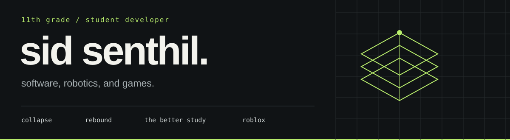

i'm sid, an 11th grader building apps for school, working on robotics, and making a co-op roblox game. most of my work is in typescript and react, with python, java, and luau along the way.

### projects

| project | what it does | take a look |
| :--- | :--- | :--- |
| **collapse** | tasks, assignment feedback, email drafts, and deadlines in one student workspace. started as signal. | [overview](https://github.com/sidsenthilkumar-dev/Signalapp) |
| **rebound** | recovery check-ins, movement guides, and experimental camera-based rep counting. my **congressional app challenge** project. | [code](https://github.com/sidsenthilkumar-dev/congressapp) · [demo](https://congress-two.vercel.app/#today) |
| **the better study** | turns course materials into practice questions, flashcards, notes, and guided study sessions. | [try it](https://the-better-study.vercel.app/) |
| **defend the hatchery** | a co-op roblox game about hatching pets and protecting a shared egg nest through enemy waves. | source not published yet |

### small projects

[camera tracker, pathfinder, gravity sandbox, reaction timer, typing practice, pixel pad, and basketball shot chart](https://github.com/sidsenthilkumar-dev/small-projects).

seven new browser experiments with setup notes and checks. the camera tracker uses a pretrained mediapipe model.

### a closer look

**collapse**  
quick task capture is only part of it. assignment review turns missing requirements into tasks, and the email workspace lets you edit a draft before sending it. the interface keeps the work in focus.  
react · typescript · vite · node.js · source currently private

**rebound**  
the camera feature uses mediapipe joint estimates to count reps on supported movements. it checks framing and pauses when tracking is lost. the journal and guided routines also work without camera tracking. it's a prototype, and tracking accuracy hasn't been clinically validated.  
react · typescript · mediapipe pose · expo

**the better study**  
a wrong answer starts a guided step, then gives the student another problem using the same skill. saved practice, editable notes, and separate subject progress keep studying organized across sessions.  
javascript · vercel serverless functions · supabase · source currently private

**defend the hatchery**  
players prepare during the day and defend the nest at night. pets fight alongside the team. the project is built around luau and a rojo structure.  
roblox · luau · rojo · in development

---

outside these projects: robotics, basketball, and piano.
